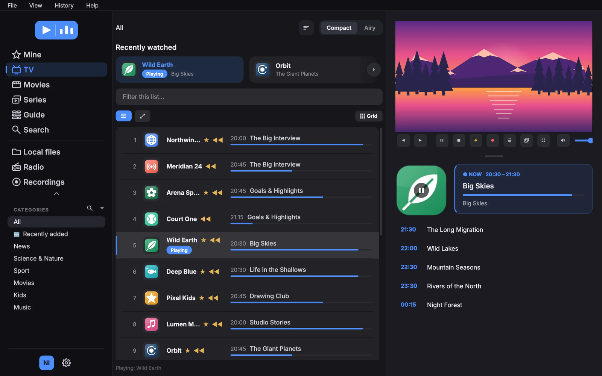
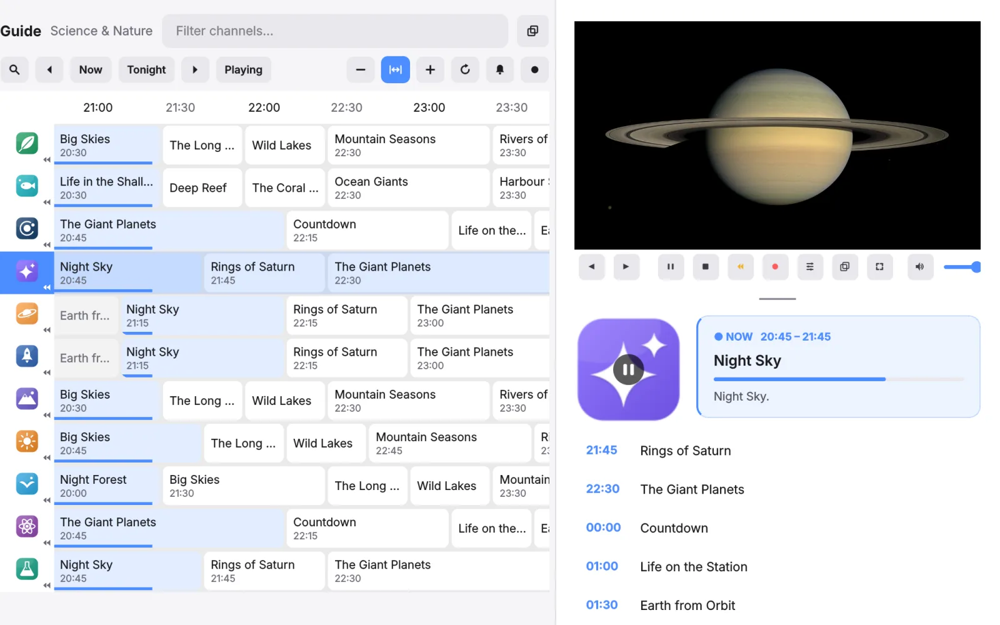
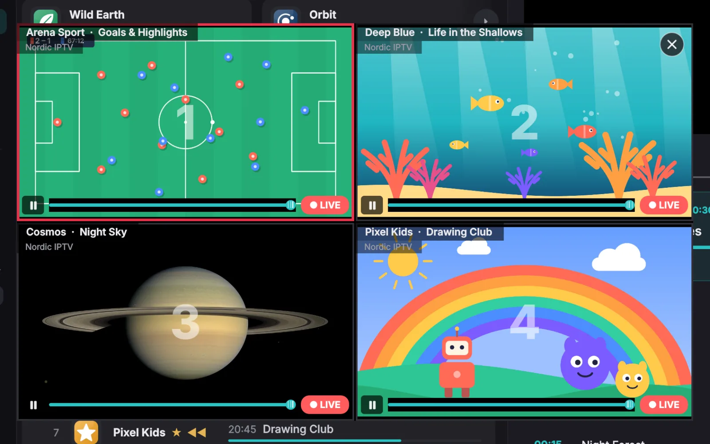
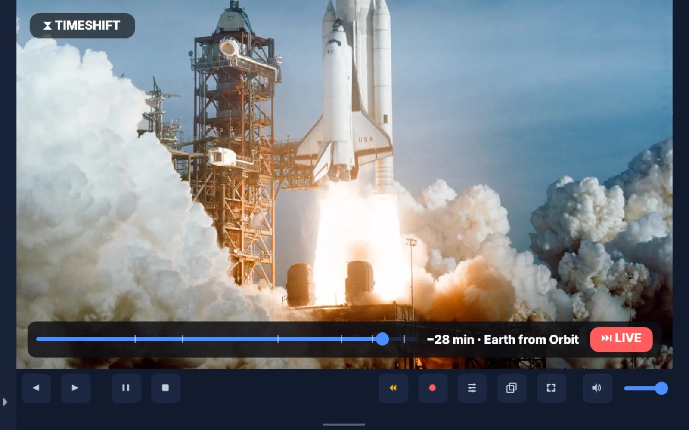

# dopeIPTV

**Website, downloads and help: [dopeiptv.org](https://dopeiptv.org/?ref=github)**

I was looking for a good IPTV-client on Linux but couldn't find one. So I built
dopeIPTV based on what I think is a good IPTV-player. I think you will like it.

It's primarily for Linux — and runs on **macOS** and **Windows** too — with a
modern interface, supporting the **Xtream Codes API**, **M3U playlists** and
**Stalker / Ministra portals** as well as the receivers, TV servers and media
servers at home, a full **EPG**, rewinding live TV, and an
**embedded mpv** video player (with optional external mpv/VLC playback).

> **dopeIPTV is a player, not a content source.** You connect it to a service
> you already subscribe to (an Xtream Codes account, an M3U playlist or a
> Stalker portal) or to your own receiver or media server — it
> doesn't provide any channels itself. The built-in **demo channels** are free,
> public test streams so you can try the app with nothing to configure.

## Screenshots

|  |  |
|---|---|
|  |  |
| *Live TV with the programme guide* | *The guide's timeline grid* |
|  |  |
| *Multiview: up to nine live channels at once* | *Timeshift: rewind a live channel* |

## Features

- **Embedded video** via libmpv's OpenGL render API — plays right inside the app on any compositor (GNOME, KDE, Hyprland, ...), with fullscreen, a pop-out window (detach to a second screen, optionally always-on-top), a hover scrubber and arrow-key seeking
- **Your provider, and the boxes and servers at home** — Xtream Codes logins, M3U playlists and Stalker / Ministra portals (portal address + MAC; *experimental*); Enigma2 receivers (VU+, Dreambox, Zgemma, ...), Tvheadend, HDHomeRun, SAT>IP servers (a Fritz!Box Cable, Octopus NET, minisatip, ...), VDR, DVBViewer, NextPVR and MythTV with their channels, guide and recordings; and Jellyfin, Emby and Plex with your own films and series, their resume points and watched marks. **Find on my network** looks for them, and each source has a page of its own in Settings
- **TV, Movies & Series** — every series with a page of its own (seasons in a row, episodes as cards with their progress, one button that plays on), favorites, history, resume where you stopped, and **one search across all your sources** (channels, the guides, movies and series) — and `Ctrl`+`K` (`⌘`+`K` on a Mac) finds an action, a setting, a channel or a programme from one field
- **Profiles** — one per person in the household, each with its own favorites, history, Continue watching, watched marks and theme; "Who's watching?" at start, a PIN if you like, and kids profiles that never see a locked or adult category
- **TV mode and a phone remote** — a full-screen layout for the sofa (`Ctrl`+`Shift`+`T`), run from a remote, a game controller or LIRC: Home, channels with what is on, the guide, movies and series in posters, search with an on-screen keyboard. And your phone as a remote over the home network: scan a code, and it plays channels, favorites, films, a series' episodes, your files, radio and recordings, shows what is on now and next, rewinds live TV, records, picks the sound track and subtitles and sets a sleep timer, and in TV mode turns into a d-pad or a touchpad — on its home screen as *dopeIPTV Remote*, with nothing to install
- **Multiview** — watch 2/4/6/9 live channels at once in a separate grid, each an independent stream (even from different playlists), with per-window audio/subtitles, click-to-focus audio and a real timeshift timeline on catch-up channels
- **Rewind live TV** — pause and go back in the channel you are watching, even without your provider's catch-up: a few minutes in memory, up to 6 hours on disk, or (*experimental*) **dopeIPTV's own buffer**, which goes on downloading while you pause, comes back to live without reconnecting, keeps each channel's history for when you return and records from the buffer
- **Mine, TV, Movies and Series** — the sidebar is the app, and it opens where you left off. Mine holds what is yours: continue watching with the time left, your favourite channels live now in the order you usually watch them, favourite films and series, Watch later as a queue, new episodes of the series you follow (with a notification) and History by day; TV shows the channels with what is on and next; Movies and Series show this week's popular titles your provider has and Continue; every series has a page of its own, and a film shows its plot, cast and a Continue button in the column beside the list
- **Watch together** — start a room, share its code, and friends watch the same film, episode or channel in step, each from their own source; the messages are encrypted with a key made from the code, so dopeiptv.org only passes them on
- **27 languages** — from English, Svenska and Español to 中文, 日本語, हिन्दी and العربية, with full right-to-left support (Arabic, Persian, Hebrew, Urdu) — switchable live in Settings
- **Local files** — point it at a folder (or a mounted network share) and browse your own videos beside the provider's: a folder view and a library view that builds series with seasons out of the file names, TMDB posters, resume, History, Trakt, casting and multiview. Music gets album art and a play queue that advances on its own
- **Internet radio and web streams** — stations from radio-browser.info by country, language and genre, kept among your favorites; and YouTube Live, Twitch and similar sites through yt-dlp (**Open address…**, `Ctrl`+`L`), which the app can download for you
- **Full EPG** with now/next progress bars, a searchable guide, and a persistent disk cache that shows instantly on startup
- **TMDB metadata** — posters, ratings (linked to IMDb), and a clickable cast list that finds an actor's other titles in your playlist
- **Recording & Timeshift** — record on a timer/schedule (single-connection friendly) or a whole series by its title or a word (or a reminder for each airing instead), and watch catch-up archives from the EPG; recordings can be saved as MP4, and reminders and recordings to come export to your calendar
- **Subtitles and teletext** — find subtitles on OpenSubtitles for the film or episode you are watching, remembered for next time, or load a file; a channel's DVB subtitles and teletext subtitle pages in the subtitle menu by language; and, with dopeIPTV's own rewind buffer on, a teletext viewer (`T`) with the colour keys, subpages, hold and reveal
- **Cast to a Chromecast, a smart TV or Kodi** — Samsung, LG, Sony and other DLNA/UPnP TVs and Kodi show up beside the Chromecasts, and on macOS an Apple TV through AirPlay; a card in the video's place shows what plays and on which TV, with pause, seek and volume (on an Apple TV a channel plays live, and its own remote sets the volume), a TV stuck buffering is sent the stream again by itself, a channel picked while casting goes to the same TV, and a device on another part of the network can be added by its address
- **Enigma2 from the app** — the box's signal, a screenshot of its TV, its remote control and its recordings; its channel lists edited from the computer, with a backup first; its AutoTimer rules beside the app's series rules; and it asks first when a stream would cut off a recording or what the box's TV shows
- **System media controls** — the keyboard's media keys and the system's own controls pause, play and skip, and show what is playing: GNOME/KDE media controls, headphone buttons and KDE Connect on Linux (MPRIS), Control Center, the lock screen and AirPods on macOS (Now Playing), the media box by the volume and the lock screen on Windows
- **Trakt and Simkl** scrobbling, **Discord status** if you want it, **multiple playlists** (drag to reorder, export/import, or drop an M3U file or link on the window), parental control, content manager and editable channel lists
- **Night mode, statistics and private viewing** — night mode (`N`) brings loud adverts, bangs and scenes down towards speech, never louder; **Your statistics** shows what you watch, counted on this computer only; private viewing keeps nothing until the app closes
- **Sync and backup** — favorites and settings, and if you like playlists and watch history, the same on all your computers, encrypted on your computer with a code only your computers know; or everything in one backup file
- **Themes** — 25 themes picked from previews — dark and light, and some with a colour of their own (sea, forest, wine, neon, an amber terminal, coffee, sand, sky) — 10 accent colours or any colour you like, follow the desktop's light/dark mode, corner style and interface size — all applied live
- **Nerd** — off until you turn it on, for those who like to tinker: Test connection, backup addresses, own DNS over HTTPS, a trusted certificate per source, low latency for live, stream analysis (a simple TR 101 290), failover to another source, stream health, picons, udpxy, a server for the home (an HDHomeRun tuner for Plex, Jellyfin and Emby, a playlist for VLC and Kodi, also as `dopeiptv --server` without a window), a remote API, webhooks and MQTT for Home Assistant, and searching the other parts of a home network split in VLANs
- **Updates itself** — the AppImage, the installed Windows app and the Mac app download, verify and swap in a new release from the update banner; official builds carry a signed list of their own files, so a changed copy is told apart; **Settings → General → Update channel → Test builds** offers the next version's test builds early

See [FEATURES.md](docs/FEATURES.md) for the full feature list.

## Dependencies

dopeIPTV's embedded player is built around **libmpv** and its Record/Cast
features around **ffmpeg** and **pychromecast**, so these are required, not
optional:

| Component | Provides | Required |
|---|---|---|
| `python3` (≥ 3.11) | runtime | ✅ |
| `mpv` / `libmpv` | embedded video playback | ✅ |
| `python-mpv` | Python binding to libmpv | ✅ (pip) |
| `ffmpeg` | recording backend | ✅ |
| `pychromecast` | Chromecast casting | ✅ (pip) |
| `vlc` | optional *external* player only | ⬜ |
| `yt-dlp` | YouTube, Twitch and similar sites (the app can download the official build into your data folder) | ⬜ |
| `pysdl2` | game controllers in TV mode (on Linux, pads are also read without it) | ⬜ |

The Python packages (`PyQt6`, `requests`, `python-mpv`, `pychromecast`) are
installed automatically by pip/pipx from `requirements.txt` — on macOS and
Windows with the bridges to the system's media controls (and AirPlay on
macOS). The system packages (`mpv`, `ffmpeg`, and optionally `vlc`) come
from your distro.

## Installation

### Option A — download a ready-to-run build (easiest, no dependencies to install)

Grab the latest build for your system from the
[Releases page](https://github.com/slimture/dopeIPTV/releases) or
[dopeiptv.org](https://dopeiptv.org/?ref=github). Every packaged build bundles Python,
PyQt6, libmpv and ffmpeg, so the **embedded** player works out of the box —
nothing else to install.

**Linux** — a self-contained `dopeIPTV-*.AppImage`, a `.deb` for
Debian/Ubuntu (both for x86_64 and ARM64, e.g. a Raspberry Pi), or a
`.flatpak` (x86_64; the newest of the formats). For the AppImage:

```bash
chmod +x dopeIPTV-*.AppImage
./dopeIPTV-*.AppImage
```

(The AppImage offers, on first run, to add itself to your application menu —
which is also where a Wayland desktop reads the window's icon and name from.
Say no and nothing is written; the same switch lives under **Settings →
General**. [Gear Lever](https://flathub.org/apps/it.mijorus.gearlever) and
AppImageLauncher do the same job if you prefer to manage it yourself.)

**macOS** — two `.dmg` files: `macOS-arm64` for Apple Silicon (M-series,
macOS 15 or later) and `macOS-x86_64` for Intel Macs (macOS 14 or later).
Not sure which Mac you have? Apple menu → About This Mac. (From 1.2.11 to
1.3.0 there was no Intel build; it came back in 1.4.0, built with mpv and
ffmpeg from conda-forge after Homebrew stopped building binary packages
for Intel Macs.)

Open the `.dmg` and drag dopeIPTV to Applications. The app is signed by
Solecraft AB and notarized by Apple, so it opens like any other app; macOS
only asks once whether to open something downloaded from the internet.
A `.dmg` downloaded before 13 November 2026 is not notarized: allow its
first launch under **System Settings → Privacy & Security → Open Anyway**,
or download the current one.

**Windows** — from 1.4.5 an installer, `dopeIPTV-*-windows-x64-setup.exe`
(and `-windows-arm64-setup.exe` for Snapdragon laptops): it installs for
your user only, without admin rights, adds dopeIPTV to the Start menu and
to **Settings → Apps**, and the installed app updates itself. Uninstalling
it there removes everything dopeIPTV kept - settings, playlists, history,
caches and its shortcuts - except your own recordings. Or the
portable `dopeIPTV-*-windows-x64.zip`: unzip the folder and run
`dopeiptv.exe`; a Start-menu/desktop shortcut lives under **Settings →
Advanced → Create shortcut**, and the bundled `README.txt` covers removing
every trace of the app. The app isn't code-signed for Windows yet, so
SmartScreen may show *"Windows protected your PC"* — click **More info →
Run anyway**.

> Linux is the primary target; macOS and Windows are a bonus.

> **Note — "Open externally" needs a system player.** The built-in embedded
> player is fully self-contained. But the right-click **Open externally**
> option (and the separate-window mpv mode) launches a *standalone* `mpv` or
> `vlc` from your system, so those features only work if you have `mpv`
> and/or `vlc` installed via your distro:
>
> ```bash
> sudo apt install mpv vlc      # Debian/Ubuntu
> sudo dnf install mpv vlc      # Fedora
> sudo pacman -S mpv vlc        # Arch
> ```

### Option B — install from source with pipx

```bash
git clone https://github.com/slimture/dopeIPTV.git
cd dopeIPTV
./install.sh
```

`install.sh` detects your package manager (apt / dnf / pacman), installs the
system dependencies, then installs dopeIPTV with `pipx`.

To do it manually instead:

```bash
# Debian/Ubuntu
sudo apt install python3 python3-pip pipx mpv ffmpeg   # add vlc for external playback
# Fedora
sudo dnf install python3 python3-pip pipx mpv ffmpeg
# Arch
sudo pacman -S python python-pipx mpv ffmpeg

pipx ensurepath
pipx install .
```

`pipx install .` also installs PyQt6, requests, python-mpv and pychromecast.

### Updating

Your settings, playlists and favorites are kept whichever way you update.

- **AppImage** — from 1.2.15 on it updates itself: when a new version is
  out, **Update now** in the banner (or in About) downloads it from
  dopeiptv.org, checks its SHA-256, test-starts it and swaps it in, then
  offers to restart. With an
  older AppImage, download the new one, make it executable, delete the old
  file and start the new one — the menu entry follows it.
- **.deb** — install the new package over the old one:
  `sudo apt install ./dopeiptv_<version>_amd64.deb`.
- **Flatpak** — install the new `.flatpak` the same way as the first one;
  it replaces the old version.
- **Windows** — installed with the installer (from 1.4.5), it updates
  itself: **Update now** downloads the next installer, checks it, closes
  the app, installs it and opens it again. The portable zip: close the
  app, delete the old `dopeiptv` folder and unzip the new one in its place
  (settings live in the registry, not the folder).
- **macOS** — from 1.4.5 it updates itself: **Update now** downloads the
  new version, checks that it is Solecraft AB's and notarised by Apple,
  and puts it in place when the app restarts. It needs to be in a folder
  you can write to, such as Applications; otherwise drag the new dopeIPTV
  to Applications and choose **Replace**.
- **From source** — `git pull` in your clone, then `./install.sh` again.

## Running

```bash
dopeiptv
```

The first time, a short setup asks for your provider: an Xtream Codes
server (e.g. `http://server:8080`) with username and password, an M3U
playlist URL, a Stalker / Ministra portal address with a MAC address, or
a Jellyfin, Emby or Plex server to sign in to. No account yet? Pick the
**demo channels** — free public test streams — to look around first. More
sources — the receivers and TV servers at home among them, which **Find on
my network** looks for — can be added later under **Settings → Sources**.

## Add to the application menu (optional)

The app offers this itself the first time it starts somewhere no menu
entry exists — say yes and it writes one to `~/.local/share/applications`,
say no and nothing is written. The same switch lives under **Settings →
General**, and unticking it removes the entry again.

On **Wayland this is also where the icon comes from**: GNOME and KDE take
a window's icon and name from the .desktop file matching it and ignore
what the application itself sets, so without an entry the taskbar shows a
blank placeholder however good the icon inside the download is. Installed
from the `.deb` the entry is already there and nothing is asked.

To do it by hand instead:

```bash
mkdir -p ~/.local/share/applications
cp dopeiptv.desktop ~/.local/share/applications/
update-desktop-database ~/.local/share/applications
```

The icon itself is written to `~/.local/share/icons` at every start, at
five sizes, and refreshed whenever the drawing changes. If it still does
not appear, a stale `~/.local/share/icons/hicolor/icon-theme.cache` from
some earlier tool is the usual reason — GTK reads that instead of the
directory. The app deletes one older than its own icons; deleting it by
hand costs nothing either.

## Usage

| Action | How |
|---|---|
| Play | Double-click or `Enter`, or the **▶** on the picture in the detail panel |
| Pause / stop / volume | The player bar buttons + the volume slider & mute |
| Seek (movies/series/catch-up) | Hover the video for the scrubber, or click the video and use ← / → (tap = ±10s, hold = continuous) |
| Resume where you left off | Prompted automatically when you replay a movie/episode |
| Audio track / subtitles / aspect / buffer | The ⚙ button in the player bar (also in fullscreen) |
| Stats for nerds | ⚙ → Stats for nerds (live overlay on the video) |
| Fullscreen | Double-click the video, or press `F` — `Esc` to leave |
| Pop the player out to its own window | The **⧉** button in the player bar (keep it on a second screen while you browse — click it again, or close the window, to dock it back). it's a clean title-bar-less video window by default — drag the video to move it. Right-click for **Always on top**, **Show title bar** or **Auto-hide controls**; double-click for fullscreen, `Esc` to leave it. |
| Zap to next/previous channel | Ctrl+Right / Ctrl+Left |
| Rename / hide a channel | Right-click it |
| Open in an external player (mpv/VLC) | Right-click → Open externally |
| Record a channel | Right-click → Record (or the ● REC button in the player) |
| Stop a recording | Click the red ● REC indicator under the list |
| Change theme / accent color | Settings → Appearance |
| Pause / rewind a live channel | Hover the video for the rewind bar, or pause; **LIVE** brings you back (how far back: Settings → Playback) |
| Switch between rewind and catch-up | **DVR \| TIMESHIFT** at the left of the bar, on a channel with the provider's catch-up |
| Watch a programme from the start | Right-click a ⏪ channel → Timeshift |
| Browse the full guide | **Guide** in the sidebar (↻ in the guide refreshes it, **Pop out** gives it a window of its own) |
| Filter the list you are in | The filter field in the place's header |
| Find a category | The 🔍 over the categories in the sidebar (by its name, or a channel, film or series in it) |
| Search every source | **Search** in the sidebar, or `Ctrl`+`Shift`+`F`: channels, the guides, movies and series |
| Find an action, a setting, a channel or a programme | `Ctrl`+`K` (`⌘`+`K` on a Mac) |
| Cast to a TV | The cast button in the player bar, or right-click → Cast to TV… |
| Use your phone as a remote | View → Phone remote… and scan the code |
| TV mode for the sofa | View → TV mode, or `Ctrl`+`Shift`+`T` |
| Switch source (playlist, provider, box) | The button with your source's initials at the foot of the sidebar, or Settings → Sources |

## Keyboard shortcuts

**Anywhere in the app**

| Key | Action |
|---|---|
| `Space` | Play / pause |
| `F` | Fullscreen (`Esc` to leave) |
| `Ctrl`+`←` / `Ctrl`+`→` | Previous / next channel (zap) |
| `Backspace` | Back to the last channel |
| `Ctrl`+`B` | Collapse / expand the sidebar (icon rail) |
| `Ctrl`+`Shift`+`M` | Focus mode (hide the list) |
| `Ctrl`+`G` | Open the EPG guide |
| `Ctrl`+`Shift`+`F` | Search everywhere: every source's channels, guide, movies and series |
| `Ctrl`+`Shift`+`R` | Reminders |
| `Ctrl`+`K` | Command palette: find an action, a setting, a channel or a programme |
| `Ctrl`+`Shift`+`T` | TV mode |
| `Ctrl`+`O` | Open a video file |
| `Ctrl`+`L` | Open an address (a stream, or a page on YouTube, Twitch and the like) |
| `Ctrl`+`Shift`+`N` | Private viewing |
| `Ctrl`+`Shift`+`Del` | Clear recent history |
| `M` | Mute |
| `N` | Night mode for the sound |
| `P` | Pop the player out to its own window |
| `R` | Record |
| `I` | Stats for nerds |
| `T` | Teletext (while a live channel plays) |
| `F5` | Rescan Local files (while it shows) |
| `Delete` | Remove the selected item (recordings / history) |
| `Esc` | Leave fullscreen / close a dialog |

Single-letter keys (`M`, `N`, `P`, `R`, `I`, `T`) act on the player and are ignored
while you're typing in the search box. On a Mac, `Ctrl` is `⌘`. Every one of
these but `Ctrl`+`O`, `Ctrl`+`L`, `Ctrl`+`Shift`+`N`, `Ctrl`+`Shift`+`Del`,
`Delete` and `Esc` can be changed under **Settings → Keyboard shortcuts**
(a key does one thing: given to another action, the one that
had it is left without; digits, `Enter`, the arrows, `Tab` and the media
keys stay the app's).

**With the video focused** (click the video first)

| Key | Action |
|---|---|
| `←` / `→` | Seek −/+10 s (hold to scrub continuously) |
| `↑` / `↓` | Volume down / up |
| Double-click | Fullscreen |

**In the EPG guide**

| Key | Action |
|---|---|
| `N` | Jump to *now* |
| `P` | Jump to the channel that's playing |
| `←` `→` `↑` `↓` | Move between programmes |
| `Enter` | Play the selected programme |
| `Esc` | Close the guide |

## Troubleshooting

- **Embedded playback disabled** — install `mpv`/`libmpv` and `python-mpv` (see Dependencies). Not needed for the packaged AppImage/.deb/Flatpak, which bundle the embedded player.
- **"Open externally" does nothing** — the external-player options launch a standalone `mpv` or `vlc` from your system; install one (`sudo apt install mpv vlc`). The embedded player does not need them.
- **Recording does nothing** — install `ffmpeg`; it is the recording backend.
- **Live stream won't start** — try switching **Live stream format** to `m3u8` under **Settings → Playback**.
- **No categories** — check the server URL (include the port, e.g. `:8080`).
- **No EPG for a channel** — the provider may not have a programme guide mapped to it; dopeIPTV tries three different sources (short EPG, full EPG table, XMLTV) before giving up.
- **A box, a Chromecast or a TV on another part of your network is not found** — a home network split into VLANs (a guest or gadget network) keeps searches on their own part unless the router passes them on: turn on its mDNS reflector (Avahi's reflector, "Multicast DNS" on UniFi), an SSDP relay or UPnP proxy for DLNA TVs, and an IGMP proxy for multicast TV. Or add the device by its address (the cast window's **Add a device by address…**, a box's address in **Add source**), or list the other networks under **Settings → Nerd → Network → Other networks**.
- **Fullscreen video flickers around its edges (Linux)** — that is variable refresh rate (VRR); turn it off in your display settings.
- **Anything else** — the [help page](https://dopeiptv.org/help/?ref=github) answers most questions; for a bug, open an issue with a log (`DOPEIPTV_LOG=debug DOPEIPTV_LOG_FILE=/tmp/dope.log dopeiptv`).

## Language

dopeIPTV ships with translations for **27 languages**: English, Svenska,
Español, Deutsch, Français, 中文, Русский, ไทย, Português, Italiano,
Nederlands, Polski, Hrvatski, Srpski, Ελληνικά, Türkçe, Українська, Bahasa
Indonesia, Tiếng Việt, हिन्दी, 日本語, 한국어, Kiswahili, العربية, فارسی,
עברית and اردو. The four right-to-left languages (Arabic, Persian, Hebrew,
Urdu) mirror the whole layout. Pick your language under
**Settings → General → Language**. Menus, the sidebar, settings and
notifications switch immediately.

English is the source language, inline in `dopeiptv/i18n.py`; every other
language is a single reviewable file under `dopeiptv/locale/<code>.json`, so
a native speaker can correct one language in isolation. Many of the
non-English strings started as machine translation — **corrections in your
language are very welcome**; see [`docs/TRANSLATING.md`](docs/TRANSLATING.md)
(no coding required).

## Leave a tip

dopeIPTV is free, with no ads, no tracking and no paid version. If you use
it and like it, you can say thanks with
**[a tip](https://dopeiptv.org/support/?ref=github)** - any amount you
choose, never a subscription. It is voluntary and gives nothing in return: the app is the same for
everyone. Reporting bugs and fixing a translation in your language help just
as much.

## Contributing and maintaining

- [`CONTRIBUTING.md`](CONTRIBUTING.md) — setting up, the quality gate, ground rules for pull requests.
- [`docs/MAINTAINING.md`](docs/MAINTAINING.md) — everything needed to take the project over: branches, CI, releases, the website, keys and accounts, open work.
- [`AGENTS.md`](AGENTS.md) — the guide for AI coding assistants (any of them), and a quick map for humans too.
- [`docs/ARCHITECTURE.md`](docs/ARCHITECTURE.md) and [`docs/DEVELOPER_NOTES.md`](docs/DEVELOPER_NOTES.md) — how the code is laid out and why.
- [`SECURITY.md`](SECURITY.md) — how to report a security problem privately; [`docs/SECURITY.md`](docs/SECURITY.md) — the threat model: what is protected, from whom, and what is honestly left; [`docs/SECURITY_REVIEWS.md`](docs/SECURITY_REVIEWS.md) — every review round and what was done.

## License

dopeIPTV is free software, released under the **GNU General Public License
v3 or later (GPL-3.0-or-later)** — see [`LICENSE`](LICENSE).

It builds on GPL/LGPL components including **mpv/libmpv**, **FFmpeg**,
**PyQt6** and optionally **VLC**. GPLv3 is the licence that is compatible
with all of them; see [`THIRD-PARTY-LICENSES.md`](docs/THIRD-PARTY-LICENSES.md)
for the full rationale and the licence of every dependency.

This product uses the TMDB API but is not endorsed or certified by TMDB.
dopeIPTV does not include or distribute any media, playlists or channel
data — you supply your own provider.
